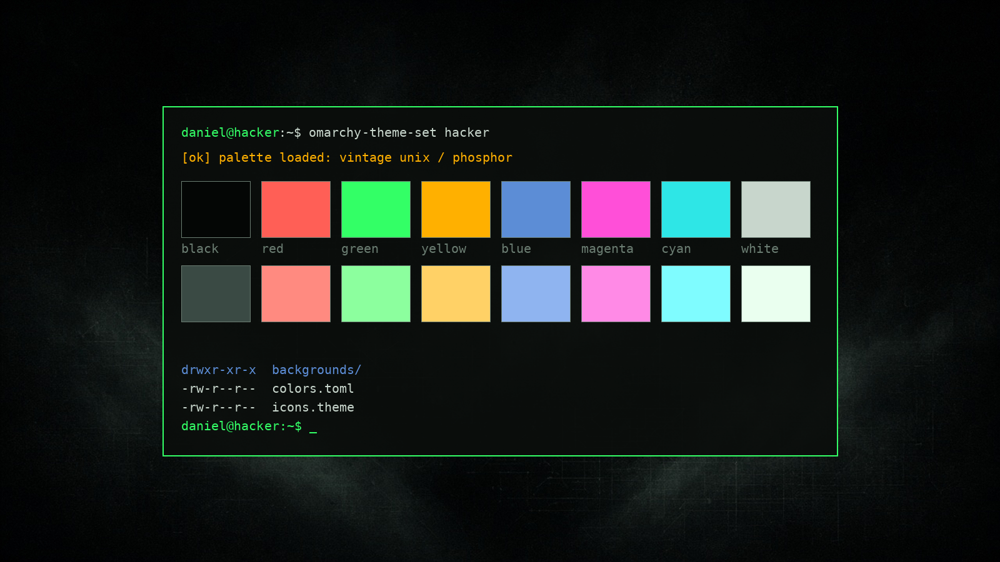

# Hacker

Ethereal near-black monochrome wallpaper (drifting mist over ghosted grid and circuit lines) with a vintage Unix workstation palette: phosphor green, amber, cyan, magenta and warm red.



## Install

```bash
omarchy-theme-install https://github.com/danielsegan/omarchy-hacker-theme
```

That one line clones the theme into `~/.config/omarchy/themes/hacker` and switches to it. You can switch back to it later from the Omarchy menu under Style, then Theme.

## Update

Run the same command again. It replaces the old copy and reapplies the theme.

## Uninstall

```bash
rm -rf ~/.config/omarchy/themes/hacker
```

Switch to another theme first if this one is active.

## What's included

- `colors.toml`: the palette. Omarchy generates the Hyprland, Waybar, Walker, Mako, SwayOSD, Hyprlock, terminal (Alacritty, Kitty, Ghostty), btop, Neovim (aether.nvim) and other app configs from it when you switch themes
- `icons.theme`: GTK icon set (`Yaru-sage`)
- `backgrounds/1-ethereal-mist.jpg`: dark monochrome mist with faint grid and circuit lines, 3840×2160
- `preview.png`: theme preview

### Palette

| Role | Normal | Bright |
|---|---|---|
| background / foreground | `#0a0d0b` | `#c8d6cc` |
| red | `#ff5f56` | `#ff8a80` |
| green (phosphor) | `#33ff66` | `#8cff9e` |
| yellow (amber) | `#ffb000` | `#ffd166` |
| blue | `#5c8dd6` | `#8fb4f0` |
| magenta | `#ff4fd8` | `#ff8ae6` |
| cyan | `#2ee6e6` | `#7ffcff` |
| orange / brown | `#ff8c3a` | `#8a5a2b` |

Accent `#33ff66`, selection `#1f3a2a`, muted `#3a4a44`.
